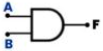
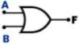
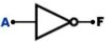

# Guía 824: Álgebra de Boole

:::{list-table}
:widths: 35 65
* - ```{list-table}
    * - 
    ```
  - ```{list-table}
    :align: left
    * - **INSTITUCIÓN EDUCATIVA**: John F. Kennedy
        - **DOCENTE**: Julian Camilo Fonseca Romero
        - **ASIGNATURA**: Lógica computacional
        - **GRADO**: OCTAVO
        - **PERIODO**: 04
        - **TIEMPO**: 10 semanas (1 hora / semana)
        - **TIEMPO DE TRABAJO**: 10/10 horas
    ```
:::

:::{tab-set}

```{tab-item} Objetivo
{bdg-light}`Exploración`
{bdg-info}`Estructuración`
{bdg-warning}`Actividad práctica`
{bdg-danger}`Transferencia`
- **Temática**: Álgebra de Boole, circuitos lógicos y compuertas digitales.
- **Objetivo de aprendizaje**: Comprender y aplicar los principios del álgebra de Boole para representar, analizar y simplificar circuitos digitales mediante el uso de compuertas lógicas y tablas de la verdad.
- **DESEMPEÑO**: Demuestra una comprensión sólida de los principios fundamentales del álgebra de Boole, aplicando eficazmente las compuertas lógicas, las tablas de la verdad y los sistemas de numeración binaria para la representación, análisis y simplificación de circuitos digitales.
```

```{tab-item} Orientaciones curriculares
- **Componente**: Naturaleza y evolución de la T&I..
- **Competencia**: Relaciono saberes, conocimientos tecnológicos e informáticos con los conocimientos de otras disciplinas.
- **Evidencia de aprendizaje**: Comprendo los principios y conocimientos tecnológicos e informáticos que hacen posible
el funcionamiento de productos tecnológicos actuales.
```

```{tab-item} Criterios de evaluación
- Actividades desarrolladas en su totalidad.
- Participación en clase.
- Explicación clara de conceptos.
- Argumentación de ideas.
- Cumplimiento de las reglas del aula.
```

```{tab-item} Recursos (2)

- **Plan de refuerzo 04.pdf** [{bdg-primary}`Descargar`](./recursos/G824/archivos/planRefuerzo04.pdf)
- [Simulador de compuertas lógicas](https://logic.ly/demo/) 

```
:::

## Mensaje del autor

:::{pull-quote}
"En esta guía se aplica el álgebra de Boole para representar, analizar y simplificar circuitos lógicos mediante compuertas y tablas de verdad. Las actividades están diseñadas para evaluar la comprensión desde lo teórico hasta la simulación práctica".

-- Camilo Fonseca
:::

---
## A00: Introducción
{bdg-light}`Exploración`

### George Boole

:::{admonition} Biografía de George Boole
:class: tip
```{list-table}
* - ```{figure} ./recursos/G824/image01.png
    :width: 222
    1815 - 1864
    ```    
```
> **NACIMIENTO**: Lincoln (Lincolnshire), Inglaterra, 2 de noviembre de 1815
>
> **MUERTE**: Ballintemple (Condado de Cork), Irlanda, 8 de diciembre de 1864

Fue un matemático y lógico británico. Como inventor del álgebra de Boole, marcó los fundamentos de la aritmética computacional moderna. Boole es considerado como uno de los fundadores del campo de las ciencias de la computación.

En 1854 publicó: An Investigation of the Laws of Thought on Which are Founded the Mathematical Theories of Logic and Probabilities, donde desarrolló un sistema de reglas que le permitían expresar, manipular y simplificar problemas lógicos y filosóficos cuyos argumentos admiten dos estados (verdadero o falso) por procedimientos matemáticos.

Se podría decir que es el padre de los operadores lógicos simbólicos y que gracias a su álgebra hoy en día es posible operar simbólicamente para realizar operaciones lógicas.
:::

### **Taller**

En su cuaderno desarrolle los siguientes puntos:

1. Transcriba la **temática**, el **objetivo de aprendizaje** y el **desempeño** de la presente guía.

2. Lea el **mensaje del autor** y responda la siguiente pregunta:

    - ¿Qué entiende por simulación?

3. Acorde a la biografía de George Boole, en media página de cuaderno opine sobre la siguiente frase:

   - "George Boole es el creador indirecto del computador".

---
## A01: Álgebra de Boole
{bdg-info}`Estructuración`

:::{admonition} ***¿Qué es el ÁLGEBRA DE BOOLE?***
:class: hint
      
Se trata de una herramienta que sirve para resolver y simplificar cualquier problema que se encuentre en los sistemas digitales.
      
El álgebra de Boole en sistemas digitales, se basa en la lógica proposicional y se utiliza para representar un circuito lógico en forma de ecuaciones.
      
A diferencia del álgebra tradicional, que se basa en números y operaciones aritméticas, el álgebra de Boole utiliza las llamadas variables Booleanas (0 y 1) y operadores lógicos (**AND**, **OR**, **NOT**) para representar y manipular los datos.

### Ventajas del álgebra de Boole

El álgebra de Boole proporciona un marco matemático riguroso para el estudio de la lógica y el razonamiento lógico, lo que ha sido fundamental para el desarrollo de la computación moderna.

El álgebra de Boole es esencial en programación, especialmente en el desarrollo de algoritmos y estructuras de control condicional. Permite:

- Evaluar condiciones.
- Tomar decisiones.
- Controlar el flujo de ejecución de un programa.

### Simplificación de expresiones

Las leyes del **álgebra de Boole** permiten simplificar expresiones Booleanas complejas, lo que facilita su comprensión y análisis.

Mediante la aplicación de técnicas de simplificación, es posible optimizar el diseño de circuitos digitales, reduciendo el número de compuertas lógicas y mejorando su eficiencia.

### Aplicaciones del álgebra de Boole

- **Diseño de circuitos digitales**: procesadores, memorias y dispositivos lógicos programables.
- **Programación y algoritmos**: el álgebra de Boole permite el control del flujo de ejecución en los programas.
- **Sistemas de control y automatización**: se utiliza en el modelo y diseño de sistemas de control, como en la industria manufacturera.
- **Criptografía**: los principios del álgebra de Boole se aplican en algoritmos criptográficos, proporcionando la base matemática para la seguridad de la información y el cifrado de datos.

:::

### **Taller**

Acorde al texto, en su cuaderno desarrolle los siguientes puntos:

1. Responda las siguientes preguntas:

   - ¿En qué se basa el álgebra de Boole?
   - ¿Qué puede representar el álgebra de Boole?
   - ¿En qué se diferencia el álgebra de Boole con el álgebra tradicional?
   - ¿Cuál es la diferencia entre una decisión y una condición? (escriba 3 ejemplos de decisiones y 3 ejemplos de condiciones)

2. Escriba **dos ventajas** que se obtienen al momento de *simplificar expresiones* mediante el álgebra de Boole.

3. En **media página**, explique que significa la siguiente afirmación:

   - "Los dispositivos digitales no entienden directamente el lenguaje humano ni tampoco entienden directamente el sistema numérico decimal".

---
## A02: Compuertas lógicas
{bdg-info}`Estructuración`

Las **Compuertas Lógicas** son circuitos electrónicos conformados internamente por transistores que generan señales de voltaje como una salida de forma booleana. Las señales de salida se obtienen por operaciones lógicas binarias (suma, multiplicación). También (niegan, afirman, incluyen o excluyen).

:::{csv-table}
:header-rows: 1
:delim: ;

AND;OR;NOT
 ;  ; 
:::

> “Las **compuertas lógicas** se pueden aplicar en otras áreas como la **mecánica**, la **hidráulica** o la **neumática**”.

> Existen diferentes tipos de compuertas y algunas de estas son más complejas. Estas compuertas complejas puedan ser simuladas como compuertas más sencillas.

Las compuertas lógicas se componen de:

- Una fórmula.
- Una representación gráfica.
- Una tabla de la verdad.

El conjunto de **compuertas lógicas** conectadas conforman un **circuito lógico**.

### Circuito lógico

:::{admonition} ¿De qué se compone un circuito lógico?
:class: tip

Un circuito lógico está compuesto por:

- Unas entradas con valores binarios.
- Una ecuación lógica que opera los valores binarios de las entradas.
- Una salida con un valor binario el cual depende de la ecuación lógica.

Las **ecuaciones lógicas** modelan el comportamiento que tendrá el circuito lógico. En ocasiones es necesario simplificar la ecuación para obtener el **mismo circuito lógico** pero con menos componentes (OPTIMIZAR).

La ***simplificación del circuito lógico*** se realiza por medio de la **simplificación de su ecuación lógica**. La simplificación de circuitos tiene las siguientes ventajas:

- Se tendrán menos componentes.
- Se utilizará un menor espacio.
- Se invertirá una menor cantidad monetaria. 

```{list-table}
* - ```{figure} ./recursos/G824/image02.png
    :width: 333
    Circuito lógico
    ```
```
:::

#### Compuerta AND

Esta compuerta es representada por una multiplicación. Indica que es necesario que en todas sus entradas se tenga un estado binario **1** para que la salida otorgue un **1** binario. En caso contrario de que falte alguna de sus entradas con este estado o no tenga si quiera una accionada, la salida no podrá cambiar de estado y permanecerá en **0**.

:::{list-table}
:header-rows: 1 
* - Fórmula
  - Gráfica
  - Tabla de la verdad
* - > $F=A.B$
  - :::{figure} ./recursos/G824/image03.png
    :width: 111
    :::
  - ```{table}
    A|B|F
    -|-|-
    0|0|0
    0|1|0
    1|0|0
    1|1|1
    ```
:::

#### Compuerta OR

Esta compuerta es representada como una suma. Indica que con cualquiera de sus entradas que este en estado binario **1**, su salida pasara a un estado **1** también. No es necesario que todas sus entradas estén accionadas para conseguir un estado **1** a la salida. Para lograr un estado **0** a la salida, todas sus entradas deben estar en el mismo valor de **0**.

:::{list-table}
:header-rows: 1 
* - Fórmula
  - Gráfica
  - Tabla de la verdad
* - > $F=A+B$
  - :::{figure} ./recursos/G824/image04.png
    :width: 111
    :::
  - ```{table}
    A|B|F
    -|-|-
    0|0|0
    0|1|1
    1|0|1
    1|1|1
    ```
:::

#### Compuerta NOT

En este caso esta compuerta solo tiene una entrada y una salida y esta actúa como un inversor. Para esta situación en la entrada se colocara un **1** y en la salida otorgara un **0** y en el caso contrario esta recibirá un **0** y mostrará un **1**. Por lo cual todo lo que llegue a su entrada, será inverso en su salida.

:::{list-table}
:header-rows: 1 
* - Fórmula
  - Gráfica
  - Tabla de la verdad
* - > $F=\bar{A}$
  - :::{figure} ./recursos/G824/image05.png
    :width: 111
    :::
  - ```{table}
    A|F
    -|-
    0|1
    1|0

    ```
:::

#### Compuerta NAND

También denominada como **AND negada**, esta compuerta trabaja al contrario de una AND ya que al no tener entradas en **1** o solamente alguna de ellas, esta concede un **1** en su salida, pero si esta tiene todas sus entradas en **1** la salida se presenta con un **0**.

:::{list-table}
:header-rows: 1 
* - Fórmula
  - Gráfica
  - Tabla de la verdad
* - > $F=\overline{A.B}$
  - :::{figure} ./recursos/G824/image06.png
    :width: 111
    :::
  - ```{table}
    A|B|F
    -|-|-
    0|0|1
    0|1|1
    1|0|1
    1|1|0
    ```
:::

#### Compuerta NOR

La compuerta OR también tiene su versión inversa. Esta compuerta cuando tiene sus entradas en estado **0** su salida estará en **1**, pero si alguna de sus entradas pasa a un estado **1** sin importar en qué posición, su salida será un estado **0**.

:::{list-table}
:header-rows: 1 
* - Fórmula
  - Gráfica
  - Tabla de la verdad
* - > $F=\overline{A+B}$
  - :::{figure} ./recursos/G824/image07.png
    :width: 111
    :::
  - ```{table}
    A|B|F
    -|-|-
    0|0|1
    0|1|0
    1|0|0
    1|1|0
    ```
:::

#### Compuerta XOR

También llamada **OR exclusiva**, esta actúa como una suma binaria de un dígito cada uno y el resultado de la suma seria la salida. Otra manera de verlo es que: con valores de entrada igual, el estado de salida es **0** y con valores de entrada diferente, la salida será **1**.

:::{list-table}
:header-rows: 1 
* - Fórmula
  - Gráfica
  - Tabla de la verdad
* - > $F = A \oplus B$
  - :::{figure} ./recursos/G824/image08.png
    :width: 111
    :::
  - ```{table}
    A|B|F
    -|-|-
    0|0|0
    0|1|1
    1|0|1
    1|1|0
    ```
:::

#### Compuerta XNOR
Esta compuerta es todo lo contrario a la compuerta XOR, ya que cuando las entradas sean iguales se presentara una salida en estado **1** y si son diferentes la salida será un estado **0**.

:::{list-table}
:header-rows: 1 
* - Fórmula
  - Gráfica
  - Tabla de la verdad
* - > $F=\overline{A \oplus B}$
  - :::{figure} ./recursos/G824/image09.png
    :width: 111
    :::
  - ```{table}
    A|B|F
    -|-|-
    0|0|1
    0|1|0
    1|0|0
    1|1|1
    ```
:::

### **Taller**

Desarrolle los siguientes puntos en su cuaderno:

1. Realice el dibujo de un **circuito lógico simple** y responda las siguientes preguntas:

   - ¿En las compuertas lógicas como se generan las señales de voltaje de salida?
   - ¿En que otros campos se puede aplicar la teoría de **compuertas lógicas**?
   - ¿Qué se obtiene cuando se modela el comportamiento de las entradas y salidas lógicas Booleanas?
   - ¿Qué es un circuito lógico y de que se compone?
   - En un circuito lógico, ¿De qué depende el valor binario de sus salida?
   - ¿Qué es una ecuación lógica?
   - En un circuito lógico, ¿De qué depende que tenga más o menos componentes?

2. Traduzca del ingles al español las siguientes palabras y en su cuaderno escriba una frase con cada una:

    - AND
    - OR
    - NOT

3. Desarrolle el siguiente crucigrama:

    :::{table}
    Horizontales | Verticales
    -|-
    *2. Modelo y diseño de sistemas de control | *1. Control de flujo en la ejecución de programas
    *7. AND, OR, NOT | *3. Algoritmos criptográficos para cifrado
    *8. Mismo circuito, menos componentes | *4. Sistemas Unos y Ceros
    *9. Cualquier cantidad, valor o hecho | *5. Conjunto de datos organizados, analizados y procesados
    *10. Procesadores, memorias | *6. Verdadero y Falso
    :::

    :::{list-table}
    * - ```{figure} ./recursos/G824/image14.png
        :width: 555
        ```
    :::

4. Copie la siguiente tabla y luego relacione con una línea la **compuerta lógica** con su **definición**:

    :::{list-table}
    * - ```{figure} ./recursos/G824/image15.png
        :width: 555
        ```
    :::

---
## A03: Números binarios
{bdg-info}`Estructuración`

> Los números binarios son un sistema de numeración cuyos valores solo pueden ser: `1` o `0`

Los **números binarios** representan los estados **FALSO** o **VERDADERO** donde:

- **0**: FALSO
- **1**: VERDADERO

Los dispositivos digitales (celular, tablet o PC) **no entienden** directamente **lenguaje humano** ni tampoco entienden directamente el **sistema numérico decimal**. Solo entienden sistema numérico 

### Tabla de conversión Decimal - Binario

:::{admonition} Tabla de conversión
:class: tip

Para entender mejor los **números binarios**, se presenta la siguiente tabla la cual muestra los **números decimales** con su **representación binaria**:

```{csv-table}
:delim: ;
:header-rows: 1
Decimal ; 8 bits
0 ; 0000 0000
1 ; 0000 0001
2 ; 0000 0010
3 ; 0000 0011
4 ; 0000 0100
5 ; 0000 0101
6 ; 0000 0110
7 ; 0000 0111
8 ; 0000 1000
9 ; 0000 1001
10; 0000 1010
11; 0000 1011
12; 0000 1100
13; 0000 1101
14; 0000 1110
15; 0000 1111
```
:::

### Conversión de decimal a binario

:::{list-table}
* - ```{figure} ./recursos/G824/image22.png
    :width: 555
    Algoritmo de conversión
    ```
:::

### **Ejercicios**

En su cuaderno desarrolle los siguientes ejercicios:

1. Escriba los números desde el 0 al 32 en "representación Digital Binaria de 8 bits" (Revise la **Tabla de conversión Decimal - Binario**).

2. Realice la conversión de los siguientes números decimales a binario:

   - 233
   - 189
   - 79
   - 88
   - 63

3. Realice la conversión de los siguientes números binarios a decimal:

   - 10010011
   - 01101101
   - 11001011
   - 11010101
   - 00110101

---
## A04: Desarrollo de ecuaciones lógicas
{bdg-warning}`Actividad práctica`

### Ejemplo 01: Ecuación lógica

Para la siguiente **ecuación booleana**, exprese su **circuito lógico** e identifique su **tabla de la verdad**.

> $$F=\overline{(A*B)}+C$$

> Para $\overline{(A*B)}$ se tiene la siguiente compuerta lógica:

:::{list-table}
* - ```{figure} ./recursos/G824/image10.png
    :width: 160
    Compuerta NAND
    ```
:::

> A lo anterior se le suma $C$ con la compuerta OR y finalmente se obtiene:

:::{list-table}
* - ```{figure} ./recursos/G824/image11.png
    :width: 370
    Circuito lógico 01
    ```
:::

Ahora se procede a desarrollar la tabla de la verdad. Para esto identificar el valor de F para las entradas A, B y C. 

> Para $A=0$, $B=0$ y $C=0$
> 
> $$F=\overline{(A.B)}+C$$
> $$F=\overline{(0.0)}+0$$
> $$F=\overline{(0)}+0$$
> $$F=1+0$$
> $$F=1$$
> 
> Para $A=0$, $B=0$ y $C=1$
> 
> $$F=\overline{(A.B)}+C$$
> $$F=\overline{(0.0)}+1$$
> $$F=\overline{(0)}+1$$
> $$F=1+1$$
> $$F=1$$

De esta forma se puede ir completando la **tabla de la verdad**:

:::{table} Tabla de la verdad circuito lógico 01

A|B|C|F
-|-|-|-
0|0|0|`1`
0|0|1|`1`
0|1|0|
0|1|1|
1|0|0|
1|0|1|
1|1|0|
1|1|1|
:::

### **Ejercicios**

En su cuaderno, para las siguientes **ecuaciones booleanas**, obtenga su **circuitos lógicos** e identifique sus **tablas de la verdad**:

1. > $F=(A+B)+(\overline{C+D})$
2. > $F = \overline{(A.\overline{B}+\overline{A}.B)+\overline{C}}$
3. > $F = \overline{(A.\overline{B}+\overline{A}.B).(C.\overline{D}+\overline{C}.D)}$
4. > $F = \overline{((A.C).(\overline{\overline{B}.C}))+((\overline{A.C}).(\overline{B}.C))}$
5. > $F = ((A+B).(\overline{\overline{C}})+(\overline{A+B}).(\overline{C}))+(\overline{C.D})$ 

---
## A05: Desarrollo circuitos lógicos

### Ejemplo 02: Circuito lógico

Para el siguiente **circuito lógico**, exprese su **fórmula** e identifique su **tabla de la verdad**.

:::{list-table}
* - ```{figure} ./recursos/G824/image12.png
    :width: 350
    Circuito lógico 02
    ```
:::

- Se tiene una primera compuerta de tipo **AND** con las entradas A y B.
- Se tiene una segunda compuerta de tipo **OR** con las entradas C y D.
- Las salidas de la primera y segunda compuerta se operan con una compuerta **NOR**.

Esto se modela de la siguiente manera:

:::{list-table}
* - ```{figure} ./recursos/G824/image13.png
    :width: 400
    Circuito lógico 02
    ```
:::

De estar forma, la formula algebraica que modela el circuito es:

> $$F=\overline{(A.B)+(C+D)}$$

Con la formula, ahora es posible obtener la tabla de la verdad. Identificar el valor de F para todas las entradas A, B, C y D.

> Para $A=0$, $B=0$, $C=0$ y $D=0$
> 
> $$F=\overline{(A.B)+(C+D)}$$
> $$F=\overline{(0.0)+(0+0)}$$
> $$F=\overline{(0)+(0)}$$
> $$F=\overline{(0)}$$
> $$F=1$$
> 
> Para $A=0$, $B=0$, $C=0$ y $D=1$
> 
> $$F=\overline{(A.B)+(C+D)}$$
> $$F=\overline{(0.0)+(0+1)}$$
> $$F=\overline{(0)+(1)}$$
> $$F=\overline{(1)}$$
> $$F=0$$
> 
> Para $A=0$, $B=0$, $C=1$ y $D=0$
> 
> $$F=\overline{(A.B)+(C+D)}$$
> $$F=\overline{(0.0)+(1+0)}$$
> $$F=\overline{(0)+(1)}$$
> $$F=\overline{(1)}$$
> $$F=0$$
> 
> Para $A=0$, $B=0$, $C=1$ y $D=1$
> 
> $$F=\overline{(A.B)+(C+D)}$$
> $$F=\overline{(0.0)+(1+1)}$$
> $$F=\overline{(0)+(1)}$$
> $$F=\overline{(1)}$$
> $$F=0$$

De esta forma se puede ir completando la siguiente **tabla de la verdad**:

:::{table} Tabla de la verdad circuito lógico 02

A|B|C|D|F
-|-|-|-|-
0|0|0|0|`1`
0|0|0|1|`0`
0|0|1|0|`0`
0|0|1|1|`0`
0|1|0|0|
0|1|0|1|
0|1|1|0|
0|1|1|1|
1|0|0|0|
1|0|0|1|
1|0|1|0|
1|0|1|1|
1|1|0|0|
1|1|0|1|
1|1|1|0|
1|1|1|1|
:::

### **Ejercicios**

Para los siguientes circuitos lógicos, obtenga su ecuación booleana e identifique su tabla de la verdad:

1. Circuito lógico 01:

    :::{list-table}
    * - ```{figure} ./recursos/G824/image16.png
        :width: 400
        ```
    :::

2. Circuito lógico 02 (tenga en cuenta la compuerta NOT):

    :::{list-table}
    * - ```{figure} ./recursos/G824/image17.png
        :width: 400
        ```
    :::

3. Circuito lógico 03 (tenga en cuenta la compuerta XORG):

    :::{list-table}
    * - ```{figure} ./recursos/G824/image18.png
        :width: 400
        ```
    :::

4. Circuito lógico 04:

    :::{list-table}
    * - ```{figure} ./recursos/G824/image19.png
        :width: 500
        ```
    :::


5. Circuito lógico 05 (Desarrollar de forma horizontal en su cuaderno):

    :::{list-table}
    * - ```{figure} ./recursos/G824/image20.png
        :width: 500
        ```
    :::

## A06: Simulación Logic.ly
{bdg-danger}`Transferencia`

1. Usando el aplicativo web: logic.ly, modele los circuitos lógicos de la **Actividad 03** y la **Actividad 04**. Para acceder al aplicativo, PULSAR clic en la siguiente imagen:

    :::{list-table}
    * - ```{figure} ./recursos/G824/image21.png
        :width: 300
        :target: https://logic.ly/demo/
        ```
    :::