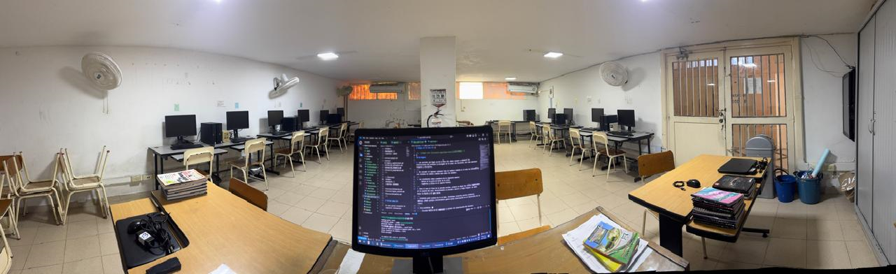

# Introducción



:::{include} ../README.md
:::

:::{list-table}
:class: none
* - ```{list-table}
    * - :::{figure} ./recursos/camilo.fonseca.png
        :width: 180
        :::
    ```
  - ```{list-table}
    * - **DOCENTE:** Julian Camilo Fonseca Romero

        **email:** camilo.fonseca@jfkennedy.edu.co

        - Ingeniero en Mecatrónica (2012)
        - Especialista en Seguridad de la Información (2015)
        - Magister en Ingeniería de Software y Sistemas Informáticos (2017)
    ```
:::

::: {admonition} PRINCIPIOS DE LA CLASE
1. "Se aprende haciendo".
2. "Se aprende enseñando".
3. "Todo se sustenta".
:::

::: {admonition} SECUENCIA DIDÁCTICA (MODELO ACTIVO)
{bdg-light}`Exploración` > {bdg-info}`Estructuración` > {bdg-warning}`Actividad práctica` > {bdg-danger}`Transferencia`
:::

:::{toctree}
:hidden:
:maxdepth: 2
:caption: Guías

1_guias/G821.md
1_guias/G822.md
1_guias/G823.md
1_guias/G824.md
1_guias/G1001.md
1_guias/G1002.md
1_guias/G1003.md
1_guias/G1004.md
1_guias/G1011.md
1_guias/G1012.md
1_guias/G1013.md
1_guias/G1014.md
1_guias/G1021.md
1_guias/G1022.md
1_guias/G1023.md
1_guias/G1024.md
1_guias/G1111.md
1_guias/G1112.md
1_guias/G1113.md
1_guias/G1114.md
1_guias/G1121.md
1_guias/G1122.md
1_guias/G1123.md
1_guias/G1124.md
:::

---
## ***Reglas del aula***

:REGLA 01: Las personas que hagan uso del sala 115, deben **atender** y **obedecer** las instrucciones del profesor (o encargado de la sala), así como mantener respeto, buen comportamiento y disciplina.

:REGLA 02: Los estudiantes deben acomodarse de la siguiente manera:
    - Bolsos en la parte de atrás de la silla.
    - Cuadernos y útiles en el soporte frontal.
    - Si hay evaluación, los bolsos deben estar en el tablero.

:REGLA 03: Para el aseo al final de la jornada escolar:
    - Primero se dejan las sillas organizadas en la esquina de la sala.
    - Posteriormente se procede a barrer y luego trapear.
    - Se debe botar la basura y el agua sucia.
    - También se debe reciclar las botellas plásticas.

:REGLA 04: Cualquier duda sobre el uso de la sala, preguntar al docente o al encargado.

:REGLA 05: Cumplimiento de la hora establecida:
    - De entrada los estudiantes deben formar dos filas. Una fila de hombres y una fila de mujeres.
    - Para permitir la entrada los estudiantes deben cumplir:
      - Portar bien el uniforme.
      - Celulares guardados en bolsos y en silencio.
      - No tener ni estar consumiendo comida o bebida alguna.

:REGLA 06: Llegada tarde:
    - Una vez cumplida la hora de entrada, se cierra la puerta y empieza la clase.
        - Se hace llamado a lista.
        - Los estudiantes que lleguen tarde permanecen afuera sin distraer, hacer ruido o desorden y se les coloca la falla por tardanza.
        - Una vez terminado el llamado a lista, los estudiantes faltantes ingresan en silencio a la sala. (Profesores dan 5 min para hacer aseo antes de entrar a la siguiente clase).

:REGLA 07: La sala de informática es exclusivamente para **realizar trabajos académicos** (que necesiten de un computador). Los trabajos deben estar relacionados con la Institución Educativa John F. Kennedy. Está prohibido hacer trabajos de cualquier otro tipo o institución ajenos.

:REGLA 08: Si el estudiante es identificado **realizando cualquier actividad ajena a lo establecido por el docente** o incumpliendo cualquiera de las presentes reglas, su equipo será bloqueado.

### PR&Oslash;HIBICIONES 

- Se **restringe la salida al baño** durante la clase, salvo en casos de emergencias médicas debidamente justificadas mediante certificado, siguiendo las directrices de coordinación.
- Consumir o ingresar cualquier tipo de **comida** o **bebida** en la sala de informática. Los residuos de comida o bebida caen sobre los equipos.
- Dejar bolsos o cualquier otro elemento encima de las mesas de los equipos. (*Los cables de alimentación se pueden desconectar y esto daña los equipos*).
- **Acostarse** en el piso de la sala.
- **Sentarse de forma incorrecta en las sillas** de la sala o **sentarse en las mesas**.
- **Gritos extemporáneos** o hablar en **voz alta**.
- **Dañar o escribir** en los muebles de la sala. (lápiz, bolígrafos, pinturas, etc.)
- **Maquillarse** en la sala.
- Realizar cualquier tipo de bailes o **expresiones corporales** en el sala.
- **Consumir** cualquier tipo de droga o estupefaciente.
- **Arrojar basura** en el sala.
- **No hacer el aseo** o hacerlo de forma mediocre.
- Esconder y robar cualquier objeto del sala o de los compañeros.
- Ocupar el puesto del compañero.
- Realizar trabajos diferentes a la asignatura en el sala.
- Quitarse los zapatos.
- Uso inapropiado del sala:
    - Invadir el espacio del docente.
    - Bajar los tacos (breakers).
    - Escuchar música en el computador o celular sin autorización del docente.
    - Ver videos en el computador o celular sin autorización del docente.
    - Jugar videojuegos en el computador o celular sin autorización del docente.
    - Manipular, portar o **dejar visible el celular** sin previa autorización del docente (jugar, redes sociales, etc.)
    - Tomar fotos, selfies o videos sin autorización del docente.
    - Manipular aires acondicionados, ventiladores, televisor, tablero.
    - Estar debajo de los aires (*El contacto directo con el aire acondicionado puede afectar la salud del estudiante*)
    - Acceder al gabinete, armario y escritorio del docente.
    - Desarmar o dar golpes a los equipos.
    - Instalar software en los equipos sin previa autorización del profesor.
    - Borrar archivos de los equipos.

### ¿Qué pasa si se incumplen las reglas?

Si el estudiante incumple alguna de las reglas, se procede con las siguientes **acciones formativas**:

- Disminución de valor de la nota en **perfil Kennediano**.
- Disminución de valor de la nota **trabajo en equipo**.
- Posible cambio de puesto de trabajo.

Mientras que el estudiante NO CUMPLA con las **acciones formativas**, se procede a:

- No calificar o evaluar cualquiera de las actividades académicas en proceso.
- No firmar paz y salvo.

### ¿Qué pasa si el incumplimiento es reiterativo?

:::{list-table}
* - ```{figure} ./recursos/reglas/image01.png
    :width: 300px
    Sin excusas
    ```
:::

En caso que el estudiante incumpla alguna de las reglas continuamente, se iniciará **proceso disciplinario** citando al acudiente, representante de curso o director de curso.


---
## **Información**

La siguiente información es útil para el estudiante.

### Útiles escolares

- Cuaderno cocido (100 hojas y cuadriculado).
- Lápiz, Borrador, Taja-lápiz.
- Bolígrafos azul, negro.
- Corrector.

### Porcentaje de notas %

:::{admonition} 50% + 40% + 10% = 100%
:class: tip

- **50% COGNITIVA:** Guías didácticas.
- **40% PROCEDIMENTAL:** Resultado general prueba INSTRUIMOS.
- **10% ACTITUDINAL** = 5% PERFIL Kennediano **+** 5% Trabajo en equipo.
:::

### Equivalencia calificación INSTRUIMOS

La siguiente tabla muestra el equivalente del puntaje de nota Instruimos (1-100) respecto al valor de la nota en la Institución Educativa (1-5).

:::{table}
Puntaje INSTRUIMOS | Nota IE
-|-
10-15	| 10
16-25	| 15
26-35	| 20
36-40	| 25
41-45	| 29
46-55	| 30
56-65	| 35
66-75	| 40
76-85	| 45
86-95	| 48
96-100	| 50
:::

### Sello docente

- Estudiante coloca la **fecha**.
- La **nota** puede ser cualitativa o cuantitativa.

:::{list-table}
* - ```{figure} ./recursos/informacion/sello.png
    :width: 400
    Sello docente
    ```
:::

### Acceso dentro y fuera del aula

Los **estudiantes** pueden acceder al **portal aula 115** desde cualquier lugar y dispositivo (celular, tablet, portátil, PC, Smart-TV) con acceso a **INTERNET**. También pueden acceder por medio de la INTRANET si están conectados a la red local del aula.

Si los estudiantes no tienen acceso a **INTERNET**, pueden descargar el **libro digital** previamente en sus equipos o smartphones.

- INTRANET: [http://192.168.115.100](http://192.168.115.100)
- INTERNET: [https://aula115.readthedocs.io](https://aula115.readthedocs.io)

### Modelo de almacenamiento Google WorkSpace&reg;

La siguiente tabla presenta la **capacidad máxima de almacenamiento** disponible para cada miembro de la comunidad educativa, de acuerdo con su rol dentro de la [Institución Educativa John F. Kennedy](https://www.jfkennedy.edu.co).

:::{table}
 rol | ACTIVO | EGRESADO | RETIRADO | PENSIONADO
-|-|-|-|-
**ADMINISTRATIVO** | 1TB | **N/A** | 16GB | 16GB
**DOCENTE** | 256GB | **N/A** | 16GB | 16GB
**ESTUDIANTE** | 16GB | 16GB | {guilabel}`X` | **N/A**
:::

{guilabel}`X` = Suspensión de la cuenta

### Acceso al aula 115 en contra-jornada

Para **asegurar y mantener la correcta funcionalidad de los equipos**, se debe tener un control y seguimiento en el aula. Es por eso que los estudiantes que deseen ***hacer uso del aula de informática 115 en contra-jornada***, deben solicitar el acceso enviando un correo a:

:Cuenta: camilo.fonseca@jfkennedy.edu.co
:Asunto: Autorización acceso aula 115 en contra-jornada

Los horarios en contra-jornada son:

- **Mañana:** 10AM-12PM
- **Tarde:** 01PM-03PM

### Acceso de estudiantes al PC

- > Estudiantes reciben acceso a los PCs.

:::{list-table}
* - ```python
    cursoActual = input("CURSO: ")

    if (cursoActual == "8A" or cursoActual == "8B"):
        usuarioEstudiante = "usuario"
    
    elif (cursoActual == "10A"):
        usuarioEstudiante = "10A"
        print("dar contraseña de acceso a 10A")

    elif (cursoActual == "10B"):
        usuarioEstudiante = "10B"
        print("dar contraseña de acceso a 10B")

    elif (cursoActual == "11A"):
        usuarioEstudiante = "11A"
        print("dar contraseña de acceso a 11A")

    elif (cursoActual == "11B"):
        usuarioEstudiante = "11B"
        print("dar contraseña de acceso a 11B")

    else:
        usuarioEstudiante = "NO INFO"
    ```
:::

### Estructura carpeta de evidencias

Los **estudiantes** deben crear el siguiente árbol de **carpetas de evidencias**:

:::{list-table}
* - ```{figure} ./recursos/informacion/image01.png
    :width: 270
    Carpeta de evidencias
    ```
:::

Los **archivos** que se trabajen en clase, deben ser clasificados en las carpetas según el periodo y la asignatura.

---
## **DESCARGAS**

Identifique el recurso y PULSE el botón **Descargar**.

### Institucional

- MANUAL DE CONVIVENCIA [{bdg-primary}`Descargar`](./recursos/descargas/manual_convivencia.pdf)
- PDF portal sala 115 [{bdg-primary}`Descargar`](./recursos/descargas/sala115.pdf)

### Proyecto de grado

- Formulario elección TEMA [{bdg-primary}`Descargar`](./recursos/descargas/formularioTema.odt)
- Plantilla Anteproyecto [{bdg-primary}`Descargar`](./recursos/descargas/ANTEPROYECTO.docx)
- Plantilla Proyecto [{bdg-primary}`Descargar`](./recursos/descargas/PROYECTO.docx)
- Plantilla Presentación [{bdg-primary}`Descargar`](./recursos/descargas/presentación.pptx)

